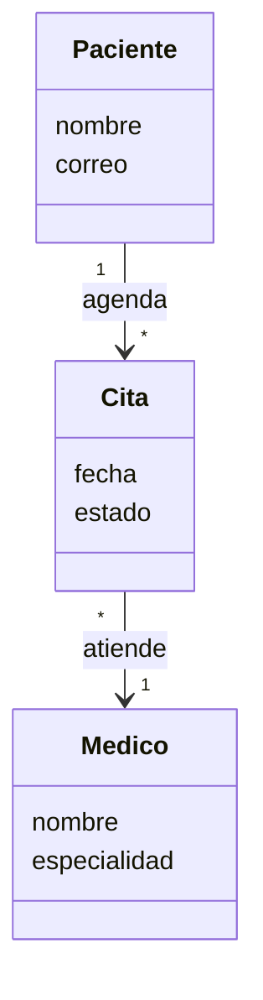

# Astah UML: instalación y primer diagrama

Astah UML es una de las dos herramientas que los talleres aceptan para modelar, junto con draw.io (por ejemplo, el Taller 3 pide «draw.io o Astah UML»). Úsela cuando necesite validación formal de UML. Para trabajo colaborativo o rápido, draw.io sigue siendo la opción por defecto del curso.

> Esta guía venía del repositorio `AREM-astah`, que quedó integrado aquí.

## Qué diagramas permite

[Astah UML](https://astah.net/products/astah-uml/) tiene licencia gratuita para estudiantes y permite crear, entre otros:

- Diagramas de clases
- Casos de uso
- Actividades
- Secuencia
- Componentes
- Despliegue

## Instalación con licencia de estudiante

1. Entre a la página oficial: https://astah.net/products/astah-uml/
2. Descargue **Astah UML** (no la versión Professional).
3. Ejecute el instalador para su sistema operativo (Windows, macOS o Linux).
4. Active la licencia gratuita de estudiante desde la sección de soporte de astah.net («Set student license»).

## Primer diagrama: sistema de citas médicas

**Objetivo:** modelar un sistema simple en el que un `Paciente` agenda una `Cita` con un `Médico`. Es el mismo dominio del caso Fundación Salud Viva de los Talleres 1 y 2.

1. Abra Astah UML y seleccione `File → New`.
2. Cree un `Class Diagram` desde el panel izquierdo.
3. Arrastre tres clases: `Paciente`, `Cita` y `Médico`.
4. Agregue atributos:
   - `Paciente`: nombre, correo
   - `Cita`: fecha, estado
   - `Médico`: nombre, especialidad
5. Conecte las clases con `Association`:
   - `Paciente` → `Cita` (1 a muchos)
   - `Cita` → `Médico` (muchos a 1)
6. Guarde el archivo como `sistema-citas.asta`.
7. Exporte una imagen desde `File → Export Image` para incluirla en el informe del taller.

El resultado esperado se ve así:

## Dónde guardar los modelos

Guarde los archivos `.asta` y sus imágenes exportadas en la carpeta `clase/` o `entrega/` del taller correspondiente, según la estructura que indica el README de cada taller.
